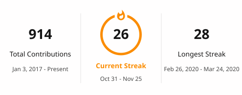

# RiemannChow

### Over 10 years of focus on AI, big data, cloud-native, IoT, and distributed messaging engines

✉️ [riemannchowcn@gmail.com](mailto:riemannchowcn@gmail.com) &nbsp;·&nbsp; 🌐 [Portfolio](https://portfolio.riemann-chow.cn/)

  <picture>
    <source media="(prefers-color-scheme: dark)" srcset="./profile/streak-dark.svg" />
    <source media="(prefers-color-scheme: light)" srcset="./profile/streak-light.svg" />
    
  </picture>

## 🔥 Featured Project

|  |  |
| --- | --- |
| **[agent-hub](https://github.com/RiemannChow/agent-hub)** | A conversational data-analysis agent built on AgentScope Java 2.0 + Spring Boot WebFlux + SeekDB |
| Stack |       |
| Highlights | ReAct orchestration · A2UI structured result cards · Hybrid retrieval (vector + full-text + scalar) · Dual short/long-term memory · DDD-layered architecture |

<picture>
  <source media="(prefers-color-scheme: dark)" srcset="https://raw.githubusercontent.com/RiemannChow/RiemannChow/output/github-contribution-grid-snake-dark.svg">
  <source media="(prefers-color-scheme: light)" srcset="https://raw.githubusercontent.com/RiemannChow/RiemannChow/output/github-contribution-grid-snake.svg">
  
</picture>

  <picture>
    <source media="(prefers-color-scheme: dark)" srcset="https://github-readme-activity-graph.vercel.app/graph?username=RiemannChow&theme=xcode&bg_color=FF000000&hide_border=true" />
    <source media="(prefers-color-scheme: light)" srcset="https://github-readme-activity-graph.vercel.app/graph?username=RiemannChow&theme=xcode&bg_color=FF000000&color=000000&hide_border=true" />
    
  </picture>

